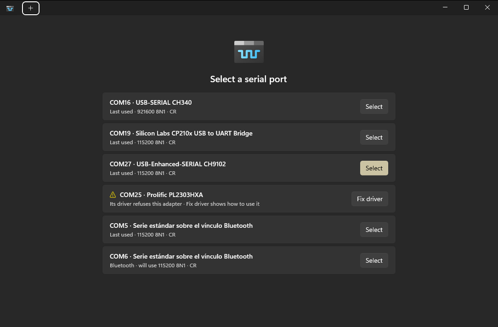

# COMrade

**A native Windows serial port utility.**

  

COMrade opens serial ports in tabs with a fast, modern terminal, and keeps working when a device is
unplugged, resets itself or comes back under a different COM number.

### Keyboard shortcuts

| Keys | Action |
|---|---|
| <kbd>Ctrl</kbd>+<kbd>Shift</kbd>+<kbd>T</kbd> | Open a port in a new tab |
| <kbd>Ctrl</kbd>+<kbd>Shift</kbd>+<kbd>W</kbd> | Close the tab |
| <kbd>Ctrl</kbd>+<kbd>Tab</kbd> / <kbd>Ctrl</kbd>+<kbd>Shift</kbd>+<kbd>Tab</kbd> | Next / previous tab |
| <kbd>Ctrl</kbd>+<kbd>Shift</kbd>+<kbd>O</kbd> | Open or close the port |
| <kbd>Ctrl</kbd>+<kbd>Shift</kbd>+<kbd>B</kbd> | Send a break |
| <kbd>Ctrl</kbd>+<kbd>Shift</kbd>+<kbd>C</kbd> / <kbd>Ctrl</kbd>+<kbd>Shift</kbd>+<kbd>V</kbd> | Copy / paste |
| <kbd>Ctrl</kbd>+<kbd>Shift</kbd>+<kbd>K</kbd> | Clear the terminal |
| <kbd>Ctrl</kbd>+<kbd>Shift</kbd>+<kbd>L</kbd> | Start or stop logging |
| <kbd>Ctrl</kbd>+<kbd>Shift</kbd>+<kbd>Home</kbd> / <kbd>Ctrl</kbd>+<kbd>Shift</kbd>+<kbd>End</kbd> | Scroll to the top / bottom |
| <kbd>Ctrl</kbd>+<kbd>Shift</kbd>+<kbd>PgUp</kbd> / <kbd>Ctrl</kbd>+<kbd>Shift</kbd>+<kbd>PgDn</kbd> | Scroll up / down a page |
| <kbd>Ctrl</kbd>+<kbd>,</kbd> | Settings |

Change them in Settings, under Shortcuts: each takes <kbd>Ctrl</kbd>, <kbd>Shift</kbd> if you like,
and one more key.

<kbd>Ctrl</kbd>+<kbd>C</kbd> copies when text is selected and otherwise reaches the device, like the
other control keys devices use.

### AI assistants

AI assistants can use your serial devices through COMrade over the [Model Context Protocol](https://modelcontextprotocol.io) (MCP).
They can list and open ports, send commands and wait for the replies, read the output, and drive DTR, RTS and break.
They can also rename, clear and log tabs.
Everything they do happens in COMrade's tabs, where you see it and can type at any time.

AI access is off until you turn it on in Settings, under AI assistants:

- **Per tab**: assistants may use only the devices whose tab has **MCP** turned on in its toolbar.
- **All ports**: assistants may open and use any port.

## Download

From the [latest release](https://github.com/antoniovazquezblanco/Comrade/releases/latest), get either:

- `COMrade-<version>-win-x64.msi`: Installs COMrade with a Start menu entry, either just for you
  (no administrator rights needed) or for every user of the computer. A newer version installs over
  it and keeps your settings.
- `COMrade-<version>-win-x64.zip`: A portable copy. Unzip it anywhere and run `COMrade.exe`.

Both include .NET and the Windows App SDK. Each file has a Sigstore signature (`.sigstore.json`) made
by the release workflow, and each release has SLSA build provenance (`.intoto.jsonl`); see
[SECURITY.md](SECURITY.md#checking-a-download) for how to check a download.

COMrade tells you when a new release is out: once a day it asks GitHub for the latest release,
sending only its version. Turn it off in Settings, under Updates.

Requirements: Windows 10 version 1809 or later, x64.

## Building

See [docs/development.md](docs/development.md) for building, testing and releasing COMrade.

## License

COMrade is released under the [MIT License](LICENSE.md). The release files also include third-party
components under their own licenses, listed in
[ThirdPartyNotices.txt](COMrade/ThirdPartyNotices.txt).
