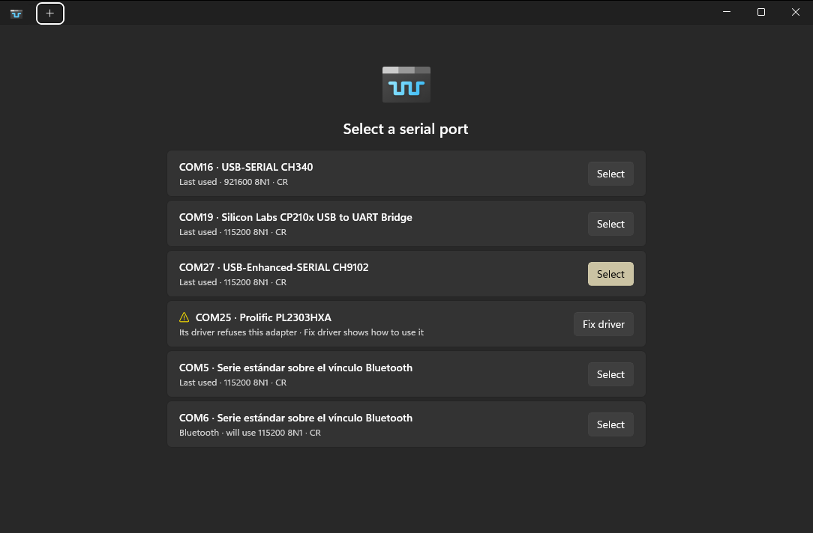

# COMrade

**A native Windows serial port utility.**

  

COMrade opens serial ports in tabs with a fast, modern terminal, and keeps working when a device is
unplugged, resets itself or comes back under a different COM number.

### Keyboard shortcuts

| Keys | Action |
|---|---|
| <kbd>Ctrl</kbd>+<kbd>Shift</kbd>+<kbd>T</kbd> | Open a port in a new tab |
| <kbd>Ctrl</kbd>+<kbd>Shift</kbd>+<kbd>W</kbd> | Close the tab |
| <kbd>Ctrl</kbd>+<kbd>Tab</kbd> / <kbd>Ctrl</kbd>+<kbd>Shift</kbd>+<kbd>Tab</kbd> | Next / previous tab |
| <kbd>Ctrl</kbd>+<kbd>Shift</kbd>+<kbd>C</kbd> / <kbd>Ctrl</kbd>+<kbd>Shift</kbd>+<kbd>V</kbd> | Copy / paste |
| <kbd>Ctrl</kbd>+<kbd>,</kbd> | Settings |

<kbd>Ctrl</kbd>+<kbd>C</kbd> copies when text is selected and otherwise reaches the device, like the
other control keys devices use.

## Download

Get the latest `COMrade-<version>-win-x64.zip` from the
[releases](https://github.com/antoniovazquezblanco/Comrade/releases/latest), unzip it anywhere and run
`COMrade.exe`. Nothing to install: .NET and the Windows App SDK come with it. Each zip has a Sigstore
signature (`.sigstore.json`) made by the release workflow.

Requirements: Windows 10 version 1809 or later, x64.

## Building

See [docs/development.md](docs/development.md) for building, testing and releasing COMrade.
